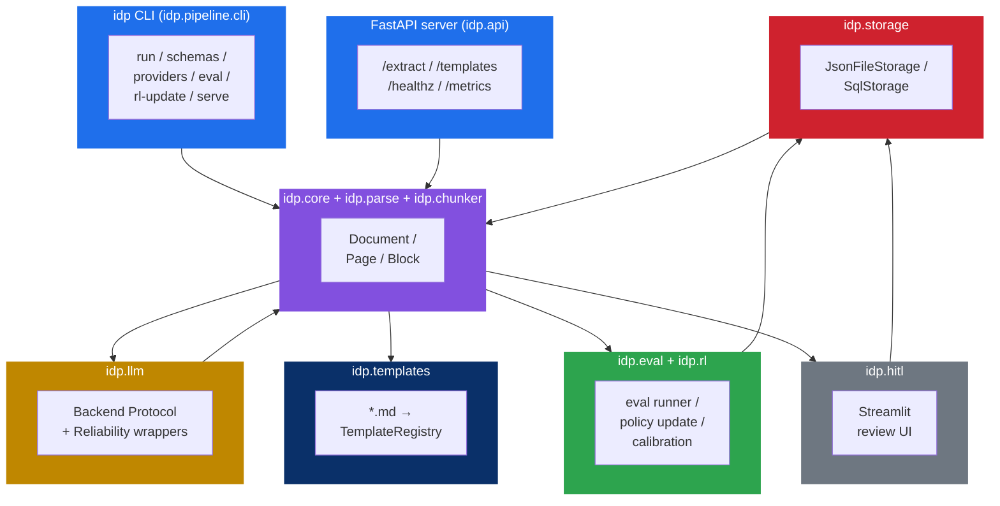
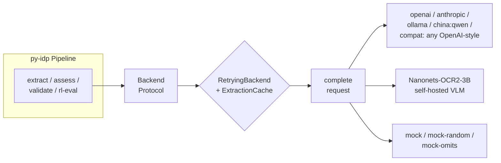

# py-idp

**Languages:** [English](https://github.com/rollroyces/py-idp/blob/main/README.md) · [繁體中文](https://github.com/rollroyces/py-idp/blob/main/README.zh-TW.md) · [简体中文](https://github.com/rollroyces/py-idp/blob/main/README.zh-CN.md)
·
[Docs site](https://rollroyces.github.io/py-idp/) · [PyPI](https://pypi.org/project/py-idp/) · [GitHub](https://github.com/rollroyces/py-idp)

---

> **General-purpose, AI-enabled Intelligent Document Processing for Python.**
> Six-stage pipeline (parse → classify → extract → assess → validate → HITL).
> 23 LLM backends. Pydantic-schema-driven. Built-in eval harness.
> **Auto-chunking for oversized documents. Self-hosted OCR via Nanonets-OCR2-3B. AI-driven schema discovery.**
> **Async pipeline + per-field eval reports (v0.5).**

[](https://github.com/rollroyces/py-idp/blob/main/LICENSE-AGPL)
[](https://github.com/rollroyces/py-idp/blob/main/LICENSE-COMMERCIAL)
[](https://www.python.org/)
[](https://github.com/rollroyces/py-idp/actions/workflows/tests.yml)
[](https://pypi.org/project/py-idp/)
[](https://pypistats.org/packages/py-idp)
[](https://github.com/rollroyces/py-idp/stargazers)
[](https://github.com/rollroyces/py-idp/blob/main/CITATION.cff)

---

## Contents

- [Install](#install)
  - [Zero-config quickstart](#zero-config-quickstart)
  - [Optional extras](#optional-extras)
- [30-second tour](#30-second-tour)
- [The pipeline](#the-pipeline)
- [LLM backends](#llm-backends)
  - [International (5 providers)](#international-5-providers-any-openai-compat-endpoint)
  - [China (8 providers)](#china-8-providers--all-speak-the-openai-chat-completions-protocol)
  - [Self-hosted (Nanonets-OCR2-3B)](#self-hosted-nanonets-ocr2-3b-on-apple-silicon--cuda)
  - [Auto-chunking](#auto-chunking-for-oversized-documents)
- [CLI](#cli)
- [Bring your own schema](#bring-your-own-schema)
- [Auto-schema discovery](#auto-schema-discovery)
- [Templates per PDF type](#templates-per-pdf-type-llm-context-via-markdown)
- [Chunking for oversized documents](#chunking-for-oversized-documents)
- [Add business rules](#add-business-rules)
- [Eval harness](#eval-harness)
- [Reliability: retries, cache, checkpoint](#reliability-retries-cache-checkpoint)
- [Production scaffolding](#production-scaffolding-built-in-optional)
- [Learning from HITL corrections (RL)](#learning-from-hitl-corrections-rl)
- [Development](#development)
- [Security](#security)
- [License](#license)

---

## Install

**Core install** (works without any API key — uses the in-tree mock backend):

```bash
pip install py-idp                # core: pydantic + typer + rich + httpx + pdfplumber + tiktoken
```

### Zero-config quickstart

```python
from idp.easy import extract_one
fields = extract_one("invoice.pdf")          # uses IDP_BACKEND env var, default "mock"
print(fields)                                 # -> dict of extracted Invoice fields
```

Drop a `invoice.pdf` (or `invoice.txt`) in the current directory and run
`python examples/00_zero_to_extraction.py` — no API key needed, prints the
extracted fields plus a hint for upgrading to a real local LLM
(`set IDP_BACKEND=ollama and run \`ollama pull qwen2.5:0.5b\``).

### Optional extras

> **All extras are OPTIONAL** — they unlock advanced features (better PDF
> table extraction, additional LLM providers, the FastAPI server, etc.) but
> none are required for the first extraction above. Install only what you need.

```bash
pip install py-idp[docling]      # IBM Docling — best PDF table extraction
pip install py-idp[ocr]           # tesseract fallback for noisy scans
pip install py-idp[openai]       # OpenAI SDK (also used for 8 China LLMs)
pip install py-idp[anthropic]    # Anthropic SDK
pip install py-idp[ollama]       # Ollama client
pip install py-idp[china]        # 8 China LLM providers via OpenAI-compatible protocol
pip install py-idp[hf-vlm]        # Self-hosted Nanonets-OCR2-3B (Apple Silicon / CUDA)
pip install py-idp[api]           # FastAPI server (idp.api:app — production-ready)
pip install py-idp[pdf-render]    # PDF → image rendering for multimodal backends
pip install py-idp[eval]          # datasets + pandas for `idp eval`
pip install py-idp[dev]           # pytest + ruff + mypy + hypothesis + pytest-benchmark
pip install py-idp[docs]          # mkdocs + mkdocstrings for building the docs site locally
```

Combine: `pip install py-idp[docling,anthropic,eval,dev]`.

> No API key needed to install or run the test suite — `MockBackend` ships in-tree.
> `tiktoken` is installed automatically by the core package (used for token-budget chunking).

---

See [CHANGELOG.md](https://github.com/rollroyces/py-idp/blob/main/CHANGELOG.md) for release notes.

## 30-second tour

```python
import idp
from idp.pipeline import Pipeline

result = Pipeline(
    backend="mock",                # or "ollama", "openai", "anthropic", "china:qwen" ...
    schema="Invoice",
    business_rules=[...],
).run(idp.Document.from_path("invoice.pdf"))

print(result.extraction)    # dict — validated against your Pydantic schema
print(result.confidence)    # dict — per-field 0..1, <0.6 flagged for review
print(result.validation)    # dict — schema + business-rule outcomes
```

**A faithful end-to-end run on the in-tree sample invoice, measured live:**

| metric | value |
|---|---|
| classification | `invoice` (conf 0.99) |
| extraction shape | 12 fields, 2 line items |
| validation | PASS |
| exact-match fields vs gold | **7 / 9 = 78 %** (single doc) |
| low-confidence flags (HITL) | 2 (subtotal, tax_amount — small-model arithmetic) |
| latency (mocked LLM) | < 2 ms |

**Full eval harness, 3 invoices, real local Ollama (`qwen2.5:0.5b`, 397 MB):**

| metric | value |
|---|---|
| schema-valid rate | **100 %** (3 / 3) |
| field F1 | **0.96** (precision 1.00, recall 0.93) |
| latency | **2.05 s / doc** on Apple Silicon |
| per-doc exact match | inv-001 7/9 · inv-002 9/9 · inv-003 9/9 |

The framework is honest about what small models get wrong: arithmetic on tiny models (`subtotal`/`tax_amount`) is flagged with conf 0.10 and routed to HITL review, not silently passed.

> **Why py-idp vs. a hand-rolled LLM script?**
>
> | | hand-rolled | py-idp |
> |---|---|---|
> | PDF parsing + table extraction | your problem | Docling, pdfplumber, plain — pick one |
> | Multi-page LLM calls | write a chunker | built-in, with per-chunk failure handling |
> | Confidence scoring | your problem | heuristic + optional LLM self-rate |
> | Schema validation | your problem | Pydantic-typed, errors surfaced in `doc.errors` |
> | HITL review | your problem | Streamlit app, persists corrections |
> | Reliability | your problem | retry, cache, checkpoint built-in |
> | Schema discovery | your problem | `discover_schema()` from a hint + a sample doc |
> | Production eval | your problem | `idp eval` with field F1 + schema-valid rate |
> | RL on corrections | your problem | `idp rl-update` — deterministic, inspectable |
> | 12+ LLM backends | your problem | one `Pipeline(backend="...")` line |
> | Dual license (AGPL + commercial) | your problem | revenue path without losing the open-source core |

---

## The pipeline

```mermaid
flowchart LR
    A[INGEST<br/>file path / URL / bytes] --> B[PARSE<br/>Docling · pdfplumber · plain]
    B --> C[CLASSIFY<br/>rule-first, LLM fallback]
    C --> D{ROUTE<br/>multimodal or<br/>OCR+LLM?}
    D -->|multimodal| E1[EXTRACT<br/>images → VLM]
    D -->|OCR+LLM| E2[EXTRACT<br/>text → LLM]
    E1 --> F[ASSESS<br/>per-field confidence]
    E2 --> F
    F --> G[VALIDATE<br/>Pydantic + business rules]
    G --> H{any low<br/>confidence?}
    H -->|yes| I[HITL<br/>Streamlit review]
    H -->|no| J[(PipelineResult)]
    I --> K[save correction<br/>+ update policy]
    K --> J

    style A fill:#1f6feb,stroke:#1f6feb,color:#fff
    style B fill:#2da44e,stroke:#2da44e,color:#fff
    style C fill:#2da44e,stroke:#2da44e,color:#fff
    style D fill:#bf8700,stroke:#bf8700,color:#fff
    style E1 fill:#8250df,stroke:#8250df,color:#fff
    style E2 fill:#8250df,stroke:#8250df,color:#fff
    style F fill:#cf222e,stroke:#cf222e,color:#fff
    style G fill:#cf222e,stroke:#cf222e,color:#fff
    style I fill:#6e7781,stroke:#6e7781,color:#fff
    style J fill:#0a3069,stroke:#0a3069,color:#fff
```



Each stage is a pure function over a `Document`. They run independently, are unit-testable in isolation, and any one can be swapped.

| stage | module | default | what it does |
|---|---|---|---|
| **INGEST** | `idp.core.document` | `Document.from_path` | Bring bytes into a `Document` (path, URL, or in-memory) |
| **parse** | `idp.parse` | Docling (PDF) · pdfplumber (fallback) · plain text | Extracts text + tables + page images |
| **classify** | `idp.classify` | rule-first, LLM fallback | Detects doc type: invoice, contract, bank_statement, … |
| **route** | `idp.parse.router` | auto | Chooses multimodal VLM vs OCR+LLM based on doc features |
| **extract** | `idp.extract` | Pydantic-schema-driven | Validated structured extraction from text or images |
| **assess** | `idp.assess` | heuristic + optional LLM self-rate | Per-field confidence 0..1 |
| **validate** | `idp.validate` | Pydantic + user predicates | Schema check + business rules |
| **HITL** | `idp.hitl` | Streamlit UI | Review low-confidence fields, save corrections |
| **pipeline** | `idp.pipeline.pipeline` | orchestrator | Composes the above, returns `PipelineResult` |

> **Legend** — blue: entry, green: parser/structure, yellow: decision, purple: extraction, red: confidence/validation, gray: human-in-the-loop, dark blue: result

### Architecture at a glance



The color coding matches the pipeline diagram above. Each box is a
subpackage you can `import idp.<name>` to use independently — `idp.core`
needs nothing from the rest, `idp.llm` only needs `idp.errors`, etc.

---

## LLM backends

`py-idp` has a single `Backend` protocol and every provider implements it. The pipeline never sees provider-specific code — it always calls `backend.complete(CompletionRequest)`.



### International (5 providers, any OpenAI-compat endpoint)

| name | notes |
|---|---|
| `openai` | GPT-4o (vision), GPT-4.1, o1 |
| `anthropic` | Claude 3.5/4 Sonnet, Claude Haiku (vision) |
| `ollama` | local `llama3.2-vision`, `qwen2.5-vl` — default base URL `http://localhost:11434/v1` |
| `vllm` / `lm-studio` / `compat` | any OpenAI-compatible chat-completions endpoint |
| `mock` | offline / CI baseline (`mock`, `mock-random`, `mock-omits`) |

```bash
export OPENAI_API_KEY=...
idp run invoice.pdf --schema Invoice --backend openai
```

### International presets (v0.5, 5 OpenAI-compat providers)

`intl:*` resolves through `INTERNATIONAL_PROVIDER_PRESETS` so you don't have to
remember endpoints. All speak the OpenAI Chat-Completions protocol.

| name | family | env var | vision model |
|---|---|---|---|
| `intl:groq` | Llama 3.x, Mixtral | `GROQ_API_KEY` | `llama-3.2-90b-vision-preview` |
| `intl:mistral` | Mistral Large / Small | `MISTRAL_API_KEY` | `pixtral-12b-2409` |
| `intl:together` | Meta-Llama, Qwen, Mixtral | `TOGETHER_API_KEY` | `meta-llama/llama-3.2-90b-vision-instruct` |
| `intl:cohere` | Command R+ | `COHERE_API_KEY` | (text-only) |
| `intl:fireworks` | Llama, Qwen, DeepSeek | `FIREWORKS_API_KEY` | `llama-3.2-90b-vision-instruct` |

```bash
export GROQ_API_KEY=...
idp run invoice.pdf --schema Invoice --backend intl:groq
# or with vision:
idp run invoice.pdf --schema Invoice --backend intl:groq --multimodal
```

Call `idp.llm.list_backends()` programmatically to enumerate every registered
provider (useful for CLI help screens, config validation, and tests):

```python
from idp.llm import list_backends
for b in list_backends():
    print(b["name"], b["family"], b["auth"])
# mock                 mock       none
# openai               international  env-or-kwarg
# anthropic            international  env-or-kwarg
# ollama               self-hosted    none
# intl:groq            intl-preset    env-or-kwarg
# intl:mistral         intl-preset    env-or-kwarg
# intl:together        intl-preset    env-or-kwarg
# intl:cohere          intl-preset    env-or-kwarg
# intl:fireworks       intl-preset    env-or-kwarg
# china:deepseek       china-preset   env-or-kwarg
# ... (8 china presets)
```

### China (8 providers — all speak the OpenAI Chat-Completions protocol)

Run `idp providers` to print the full table. Highlights:

| provider | env var | default | vision model |
|---|---|---|---|
| `deepseek` | `DEEPSEEK_API_KEY` | deepseek-chat | — (text-only) |
| `qwen` | `DASHSCOPE_API_KEY` | qwen-plus | qwen2.5-vl-72b-instruct |
| `zhipu` | `ZHIPUAI_API_KEY` | glm-4-plus | glm-4v-plus |
| `moonshot` | `MOONSHOT_API_KEY` | moonshot-v1-128k | moonshot-v1-128k-vision-preview |
| `yi` | `YI_API_KEY` | yi-large | yi-vision |
| `doubao` | `ARK_API_KEY` | doubao-pro-32k | doubao-1-5-vision-pro-32k |
| `hunyuan` | `HUNYUAN_API_KEY` | hunyuan-pro | hunyuan-vision |
| `baichuan` | `BAICHUAN_API_KEY` | baichuan4 | — (text-only) |

```python
from idp.llm import get_china_backend

backend = get_china_backend("qwen", multimodal=True)
# backend.model == "qwen2.5-vl-72b-instruct"
```

### Self-hosted (Nanonets-OCR2-3B on Apple Silicon / CUDA)

For documents you can't send to a third party. **No API key, no cloud
egress, fully offline after the first download** (~7 GB cached to
`~/.cache/huggingface/hub/`).

```bash
pip install py-idp[hf-vlm]    # adds torch + transformers + accelerate + safetensors
export IDP_ENABLE_NANONETS=1  # explicit opt-in (avoids surprise downloads)
export IDP_BACKEND=nanonets
idp run scan.pdf --backend nanonets
```

**Memory budget on Apple M4 16 GB** (float16, 448×448 image):
- weights + vision encoder + KV cache: ~8.3 GB
- OS + apps: ~3.5 GB
- headroom: ~4 GB (comfortable)

**Speed**: ~5-15 sec per page on M4. First call: 5-10 min to download
the model. Subsequent calls: ~10 s to load from cache.

**Why Nanonets-OCR2-3B**: open weights, no auth, Apache-2.0 (Qwen2.5-VL
base) — verify the Nanonets fine-tune license before commercial use.
Outperforms Tesseract on noisy scans and handles multilingual docs.

**Why gated**: model download is large and slow. We refuse to
auto-trigger it; you must explicitly set `IDP_ENABLE_NANONETS=1`.

**Platform support** (verified at construction time):

| Platform | Status |
|---|---|
| macOS arm64 (M1/M2/M3/M4, 16+ GB) | ✅ tested target, MPS |
| macOS arm64 (8 GB) | ❌ OOM (use Docling instead) |
| macOS x86_64 (Intel) | ❌ no MPS, eGPU CUDA flaky — fails loud |
| Linux x86_64 + CUDA | ✅ best (1-5s per page) |
| Linux x86_64 CPU-only | ⚠️ works, 30-60s per page |
| Linux arm64 | ⚠️ works, CPU only |
| Windows x86_64 + CUDA | ✅ same as Linux CUDA |
| Windows arm64 | ❌ PyTorch has no Windows-arm64 wheels — fails loud |

```python
from idp.llm.nanonets import NanonetsVLBackend
backend = NanonetsVLBackend(
    device="mps",          # or "cuda", "cpu", "auto"
    max_image_side=448,    # 4x less vision memory than 1024, ~95% acc
    load_in_4bit=False,    # True if you OOM at float16
)

# End-to-end with PdfPagesParser (renders pages to images)
from idp import Document, Pipeline
from idp.parse.parser import parse_document
from idp.core.schemas import Invoice

doc = Document.from_path("scan.pdf")
parse_document(doc, parser="pdf-pages")   # renders pages to base64 PNG
result = Pipeline(backend=backend, schema=Invoice).run(doc)
print(result.document.extraction)
```

### Auto-chunking for oversized documents

Nanonets-OCR2-3B has a 16k token context. A 50-page invoice PDF won't
fit in one call. `extract()` detects this and automatically splits
the input, runs the model once per chunk, and merges the per-chunk
extractions. **No glue code required** — it's invisible to the caller.

Two chunkers ship:

| chunker | when | default config |
|---|---|---|
| `PageChunker` | multimodal (NanonetsVLBackend + page images) | 4 pages per chunk, 1-page overlap |
| `TokenChunker` | text extractors (OCR + LLM) | 4000 tokens per chunk, 200-token overlap (tiktoken) |

```python
from idp.chunker import PageChunker, TokenChunker

# Tighter memory budget on a small M-series Mac
chunker = PageChunker(max_pages=2, overlap_pages=1)

# Or pass directly to the pipeline
from idp.pipeline import Pipeline
pipe = Pipeline(backend=backend, schema=Invoice, chunker=chunker)

# End-to-end: chunks, calls, merges, validates — one call
result = pipe.run(Document.from_path("huge-50-page-scan.pdf"))
```

The merged extraction includes a `_chunk_count` marker so you can
attribute cost and observability per chunk run.

**Per-chunk failure resilience:** if one chunk's LLM call fails, the
error is logged (`extract_chunk_failed[i]`) but other chunks' data is
still merged in. You get partial results + a clear error trail, not
a hard crash.

See [`src/idp/chunker.py`](https://github.com/rollroyces/py-idp/blob/main/src/idp/chunker.py) for the implementation
and [`tests/test_chunker.py`](https://github.com/rollroyces/py-idp/blob/main/tests/test_chunker.py) for the 34 tests.

---

## CLI

```bash
idp run path/to/invoice.pdf --schema Invoice --backend ollama --output out.json
idp batch path/to/invoices/ --backend ollama --schema Invoice \    # many docs in one shot
              --output out.jsonl --report report.json --dlq dlq.jsonl
idp providers                                          # full provider table
idp schemas                                            # built-in Pydantic schemas
idp discover-schema scan.pdf --hint "extract vendor_name, total_a